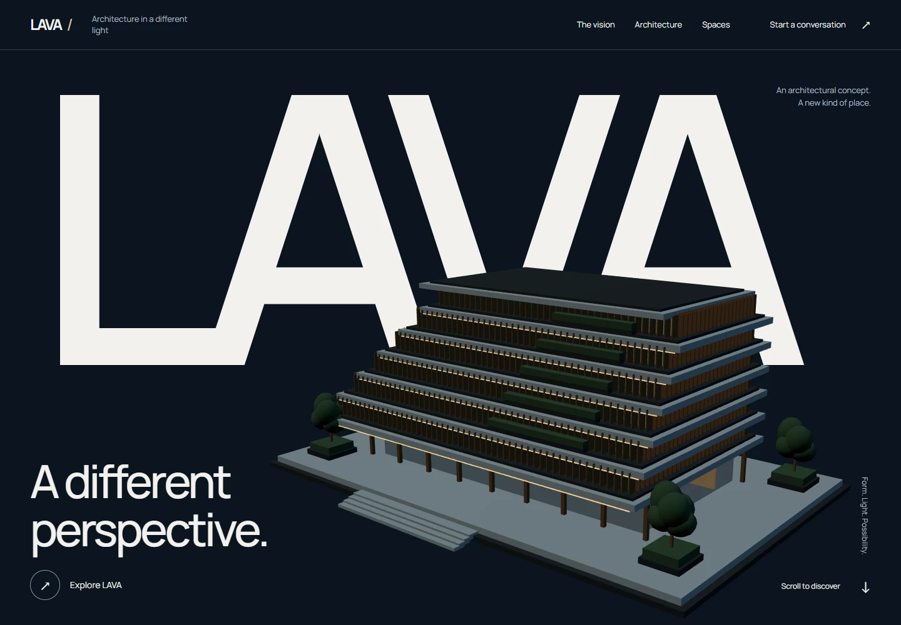

# LAVA — A different perspective

Website kiến trúc với nhận diện midnight navy, typography Manrope khổ lớn, công trình WebGL nguyên bản và hành trình từ hình khối đến không gian.

Spaces và Gallery dùng ảnh chụp thật từ Unsplash, có tác giả và link nguồn. Ảnh là tham khảo kiến trúc của các công trình hiện hữu, không phải ảnh chụp LAVA; xem [nguồn ảnh](docs/ASSETS.md).



**Hướng thị giác: CHƯA DUYỆT bởi chủ dự án.** Đây là architectural concept, chưa có thông tin dự án xây dựng hay đầu mối kinh doanh được xác thực. Xem [brand brief](docs/BRAND-BRIEF.md) và [giới hạn kiểm chứng](docs/QA.md).

## Chạy local

Khuyến nghị Node.js 24 và npm. Chrome dùng cho QA local; CI dùng Chromium do Playwright cài.

```bash
npm ci
npm run dev
```

Dev: `http://127.0.0.1:5173/`.

```bash
npm run build
npm run preview
```

Bản production local: `http://127.0.0.1:4173/`. Cần giữ terminal chạy để truy cập. Không có public deployment được công bố trong lần bàn giao này. Build tạo website tĩnh trong `dist/`, hỗ trợ hosting ở subdirectory nhờ base tương đối.

## Những gì đã xây dựng

- Hero toàn màn với wordmark riêng, công trình sáu tầng procedural, camera phản hồi theo scroll và CTA tới viewer.
- Vision và project overview theo bố cục editorial; số liệu chỉ đếm cấu trúc mô hình và các góc nhìn.
- Viewer có ba perspective, Dusk/Daylight, kéo bằng chuột, nút xoay hỗ trợ keyboard và Low power.
- Trên touch/Save-Data: bắt đầu bằng ảnh render nhẹ, tải WebGL khi chọn View in 3D / Explore in 3D, có Still view để giải phóng scene.
- Spaces, experience accordion, gallery có lightbox, phím trái/phải, Escape, swipe và trả focus về ảnh đã mở.
- Mobile menu dùng native dialog, điều hướng anchor và focus về heading đích.
- Enquiry có validation, giữ dữ liệu khi lỗi, tải đúng bản nháp xuống thiết bị; không gửi dữ liệu lên backend.
- Static fallback khi WebGL không hỗ trợ hoặc mất context; hỗ trợ reduced motion. Nội dung chính được render thành HTML lúc build, vẫn đọc và mở ảnh được khi tắt JavaScript.

## Công nghệ và source chính

Vite 8, TypeScript 6, Three.js r187, native CSS / IntersectionObserver / requestAnimationFrame. Không dùng React hoặc GSAP vì website không cần chúng. Version cụ thể trong lockfile.

| File | Trách nhiệm |
| --- | --- |
| `src/content.ts` | Nội dung dự án, views, gallery và email cấu hình |
| `src/page.ts` | Semantic HTML được Vite dựng sẵn, copy của các hành động và trạng thái |
| `src/brand.css` | Primitive và semantic tokens: màu, chữ, control, spacing |
| `src/style.css` | Layout, responsive và motion của từng section |
| `src/architecture.ts` | Hình học công trình, vật liệu, foliage và batched facade |
| `src/scene.ts` | Camera, ánh sáng, lifecycle GPU, render theo nhu cầu và cleanup |
| `src/main.ts` | Progressive enhancement: menu, viewer, gallery, enquiry |
| `tests/experience.spec.ts` | Browser regression và accessibility checks |
| `.github/workflows/ci.yml` | Lint, tokens/contrast, build và Chromium tests cho PR |

3D được tách thành chunk riêng khoảng 136 KB gzip; application JavaScript khoảng 6 KB gzip. Hero dùng direct lighting, viewer mới tạo môi trường phản xạ. Pixel ratio tối đa 1.5, Low power dùng 1. Scene ngừng render khi đứng yên, ngoài viewport hoặc tab bị ẩn. Geometry/material/texture được dispose khi đóng scene.

## Enquiry và cấu hình liên hệ

Mặc định nút **Save enquiry** tạo `LAVA-enquiry.txt`. File được tạo trên thiết bị, **chưa gửi tới ai**, không ghi nội dung form vào server hoặc localStorage. Khi tắt JavaScript, nút submit bị khóa để tránh đưa thông tin vào URL bằng GET.

Khi có inbox đã được chủ dự án xác thực, sao chép `.env.example` thành `.env.local` và đặt:

```dotenv
VITE_CONTACT_EMAIL=your-verified-inbox@your-domain.com
```

Build lại. Nút sẽ chuyển thành Prepare email và mở email app để người dùng tự xem/gửi. Đây là `mailto:`, không phải dịch vụ gửi thư; vẫn có nút lưu file nếu email app không mở. Không đưa secret vào biến `VITE_*` vì giá trị nằm trong frontend build.

## Kiểm tra

```bash
npm run typecheck
npm run lint
npm run check:design
npm run build
npm test
```

Với production preview đang chạy:

```bash
npm run test:visual
npm run measure
```

`test:visual` chụp 375, 390, 768, 1280, 1440 và 1920px, đồng thời lưu hai hướng hero và fallback. `measure` chạy Lighthouse mobile/desktop lần lượt, lưu HTML/JSON trong `qa/`. Có thể đặt `BASE_URL` và `CHROME_PATH` khi môi trường khác. Chạy phép đo khi máy không chạy browser QA khác. Để tái tạo fallback từ model, chạy dev server rồi `node scripts/render-assets.mjs`.

Kết quả, điều kiện đo, review độc lập và giới hạn nằm trong [QA.md](docs/QA.md). Báo cáo lab không chứng minh Core Web Vitals ngoài thực tế hay coverage trên thiết bị thật.

## Thiết kế, tài sản và bàn giao

- [Brand brief và các giả định](docs/BRAND-BRIEF.md).
- [Audit, phân tích tham khảo, hai hướng và quyết định thiết kế](docs/DESIGN.md).
- [Nguồn ảnh thật, tác giả và giấy phép](docs/ASSETS.md).
- [Third-party notices](THIRD_PARTY_NOTICES.md).
- [QA và trạng thái release](docs/QA.md).

UIUX AI Workspace được dùng ở nhánh main, commit `5404c183e2e6d09261ddb97b238e09ab56bd5a8a`, chỉ đọc. Không chép thư viện skill, checker hoặc tài sản Likova vào repository này.
