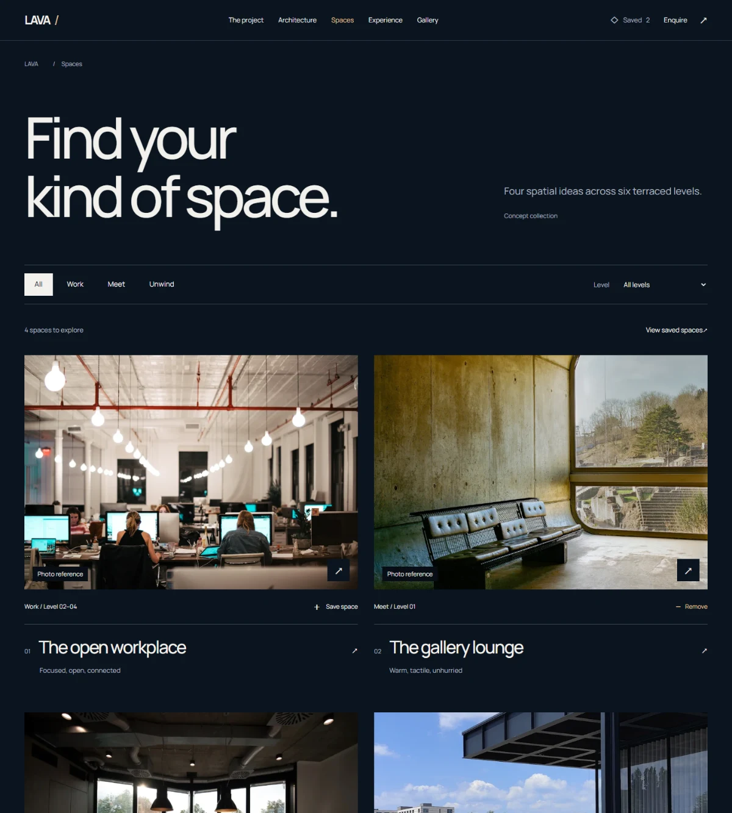

# LAVA — A different perspective

Website dự án kiến trúc với **17 trang HTML riêng**, mô hình kiến trúc GLB có giấy phép, danh mục không gian, shortlist và enquiry ba bước. Nhận diện midnight navy, Manrope và ảnh chụp thật có nguồn.



**Hướng thị giác CHƯA DUYỆT bởi chủ dự án.** LAVA là architectural concept; chưa có vị trí, diện tích thương mại, giá, leasing availability hoặc đầu mối kinh doanh xác thực. Ảnh thật là architectural references, không phải ảnh chụp LAVA. [Nguồn ảnh và giấy phép](docs/ASSETS.md).

## Chạy local

Node.js 24 và npm. QA local dùng Chrome, CI dùng Chromium.

```bash
npm ci
npm run dev
```

Dev tại `http://127.0.0.1:5173/`.

```bash
npm run build
npm run preview
```

Production preview local tại `http://127.0.0.1:4173/`. Cần giữ terminal chạy. Chưa có public deployment được xác nhận.

## Trải nghiệm và cấu trúc trang

| Trang | Chức năng |
| --- | --- |
| Home `/` | Signature hero 3D, vision, chọn chương và không gian |
| Project `/project/` | Ý tưởng, nguyên tắc và cấu trúc sáu tầng |
| Architecture `/architecture/` | Viewer 3D, ba camera, Dusk/Daylight, kéo/xoay, Reduce detail |
| Spaces `/spaces/` | Bộ lọc nhu cầu/tầng, URL giữ state, empty/reset |
| 4 trang `/spaces/{id}/` | Workplace, Gallery lounge, Meeting suite, Open terrace; nội dung/ảnh/zoning riêng, tải SVG, save và enquiry theo ID |
| Experience `/experience/` | Nhịp sinh hoạt, liên kết đúng không gian và accordion |
| Gallery `/gallery/` | Phân loại ảnh, lightbox, keyboard, swipe, nguồn ảnh |
| Saved `/saved/` | Lưu trên browser, bỏ/hoàn tác, empty state, enquiry cả lựa chọn |
| Enquiry `/enquiry/` | Nhập nhu cầu, validation, giữ draft trong tab |
| Review `/enquiry/review/` | Đối chiếu dữ liệu và quay lại sửa |
| Ready `/enquiry/ready/` | Tải file thật, email tùy cấu hình, xác nhận trước xóa draft |
| Contact, Credits, Privacy | FAQ, nguồn dự án, tác giả/giấy phép và xử lý dữ liệu |
| `404.html` | Trang phục hồi với link về danh mục |

Luồng chính: **khám phá → lọc → chi tiết → lưu → xem lại → enquiry → sửa/review → tải file**. Các anchor cũ như `/#spaces`, `/#gallery` và `/#enquiry` chuyển tới trang tương ứng khi bật JavaScript.

## Công nghệ và source

Vite 8, TypeScript 6 strict, Three.js r187, native CSS, IntersectionObserver/rAF và native dialogs. Không thêm runtime dependency cho lần mở rộng nhiều trang.

| File | Trách nhiệm |
| --- | --- |
| `src/page.ts` | Route catalogue, shared shell và các trang nội dung |
| `src/sections.ts` | Hero, vision, overview, viewer, experience, lightbox dùng lại |
| `src/enquiry-page.ts` | Markup ba bước enquiry và xác nhận xóa |
| `src/spaces.ts` | ID, nội dung bốn không gian và bốn zoning SVG nguyên bản |
| `src/journey.ts` | Bộ lọc, shortlist, autosave, review và tải file |
| `src/content.ts` | Brand content, camera perspectives, ảnh và nguồn credit |
| `src/main.ts` | Motion, menu, lifecycle scene và gallery keyboard/touch |
| `src/architecture.ts`, `src/scene.ts` | Tải GLB, vật liệu, camera, GPU và fallback |
| `src/brand.css`, `src/style.css` | Semantic tokens và stylesheet nguồn duy nhất |
| `vite.config.ts` | Prerender HTML riêng, relative assets, canonical/404 preview |
| `tests/` | Regression hành vi, responsive, accessibility và static subdirectory hosting |

Build tạo sẵn nội dung HTML cho mọi URL. Các trang có thể refresh/deep-link mà không cần client router hoặc SPA rewrite. JavaScript ứng dụng khoảng 10 KB gzip; scene + GLTFLoader riêng khoảng 157 KB gzip. Trên touch/Save-Data, ảnh still được dùng trước; chỉ tải WebGL khi yêu cầu. Scene ngừng render khi đứng yên/ngoài viewport/tab ẩn, giới hạn DPR 1.5 (Reduce detail: 1), có cleanup và fallback/context-loss handling.

## Mô hình 3D miễn phí

**Modern Office Building — CN Entertainment**, [Sketchfab](https://sketchfab.com/3d-models/modern-office-building-3f54b8d7a7064b0da523c49187efcf60), **CC BY 4.0**. GLB 1.72 MB tự host tại `public/models/modern-office.glb`; tải qua bản phân phối công khai Objaverse của Ai2, không cần tài khoản. Nguồn và license đối chiếu cả Sketchfab API lẫn metadata nhúng trong GLB. [Provenance, quyền sử dụng và thay đổi](public/licenses/Modern-Office-Building.txt).

Hero và viewer cùng tải GLB bằng addon GLTFLoader của Three.js. Giữ hình học của tác giả, chỉnh kính/ánh sáng/camera theo LAVA và ẩn nền sân nguồn để công trình có tỷ lệ phù hợp. Ba ảnh still được render lại từ cùng mô hình. Scene có tải bất đồng bộ, hủy fetch khi dispose, giải phóng geometry/material/texture/ImageBitmap và fallback nếu GLB lỗi hoặc WebGL không dùng được. Trên mobile, model chỉ tải sau khi bấm 3D.

Đây là **mô hình tham khảo có credit**, không phải thiết kế kiến trúc độc quyền của LAVA. Chương trình không gian sáu tầng và zoning sketches là đề xuất riêng, không phải bản vẽ hay số liệu xác thực của công trình này. Phần enquiry vẫn tải file trên thiết bị vì chưa có inbox/backend kinh doanh xác thực.

## Dữ liệu và enquiry

- `lava.saved.v1` trong localStorage chỉ lưu space IDs, không PII. Có remove/undo và clear/undo.
- `lava.enquiry.v1` trong sessionStorage của tab lưu contact details, nhu cầu và lựa chọn để review/edit. Có xác nhận xóa draft. Không đưa PII vào URL, không POST dữ liệu.
- Khi browser chặn storage: báo lỗi thật, giữ form và cho tải bản enquiry trực tiếp. Không báo đã lưu khi ghi storage thất bại.
- **Download enquiry** tạo `LAVA-enquiry.txt` trên thiết bị. Đây không phải gửi thư, đặt chỗ hoặc booking.
- Nếu có inbox đã xác thực, cấu hình `.env.local`:

```dotenv
VITE_CONTACT_EMAIL=your-verified-inbox@your-domain.com
```

Build lại. Bước Ready sẽ có thêm link mở draft trong email app để người dùng tự review/gửi. Không đặt secret vào biến `VITE_*`.

## Hosting tĩnh

Upload nội dung `dist/`, giữ cấu trúc thư mục và phục vụ `index.html` trong từng thư mục. Các route chuẩn kết thúc bằng `/`. Không rewrite mọi URL về trang chủ.

Trang thông thường dùng relative assets và đã có browser test dưới `/Lava/`. Error document cần biết mount path vì URL sai có thể sâu tùy ý. Nếu deploy dưới `/Lava/`, build với:

```powershell
$env:LAVA_SITE_BASE='/Lava/'
npm run build
```

Mặc định `LAVA_SITE_BASE=/`. Cấu hình host trả `404.html` với HTTP 404 cho URL không tồn tại. Vite preview đã xử lý 308 cho canonical route và 404; quy tắc server production phải được cấu hình theo nhà cung cấp hosting.

## Kiểm tra và bằng chứng

```bash
npm run typecheck
npm run lint
npm run check:design
npm run build
npm test
```

Với preview chạy:

```bash
npm run test:visual
npm run measure
```

`test:visual` chụp cả 17 trang tại 375/390/768/1280/1440/1920px, thêm scene WebGL và các trạng thái lỗi. Dữ liệu enquiry trong capture là fixture QA. Ảnh nằm trong `qa/project-screenshots/`, không dùng để giả lập UI.

`measure` lưu Lighthouse mobile/desktop tại `qa/`. Có thể đặt `BASE_URL`, `REPORT_PREFIX`, `CHROME_PATH`. Đo performance khi không chạy browser QA khác. Kết quả/điều kiện đo/giới hạn: [QA.md](docs/QA.md).

## Quy trình và bàn giao

- [Bản đồ màn, flow, owner và quyết định mở rộng](docs/PROJECT-EXPERIENCE.md).
- [Brand brief](docs/BRAND-BRIEF.md) và [nghiên cứu Likova, hai hướng hero ban đầu](docs/DESIGN.md).
- [Ảnh thật và giấy phép](docs/ASSETS.md), [third-party notices](THIRD_PARTY_NOTICES.md).
- [QA và giới hạn](docs/QA.md).

UIUX AI Workspace main `5404c183e2e6d09261ddb97b238e09ab56bd5a8a`, đối chiếu remote ngày 04/11/2026, chỉ đọc. Áp dụng brownfield/IA/FLOW, visual direction, responsive, semantic tokens, state recovery, craft QA và independent review. Không chép skill/checker/asset độc quyền vào repo. Source hiện trên branch `feat/lava-architectural-experience`, [PR #1](https://github.com/Ngh1aa/Lava/pull/1), chưa merge.
